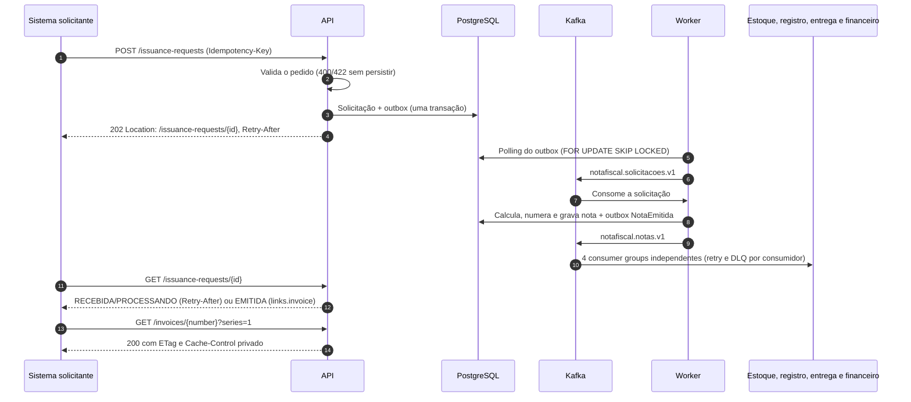
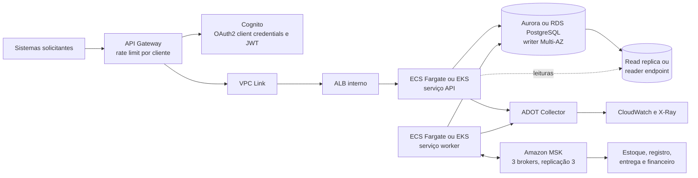
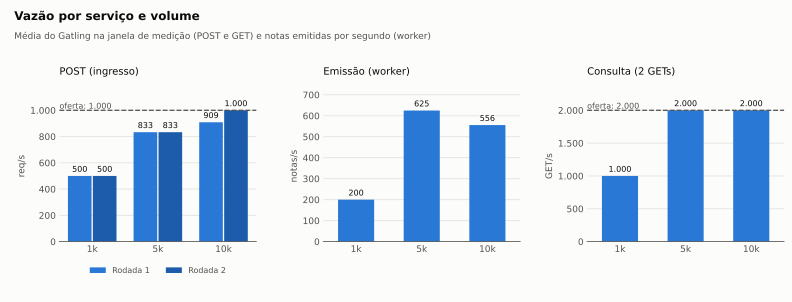
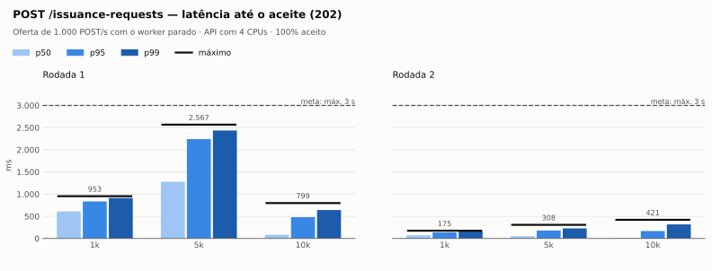
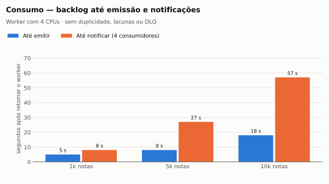
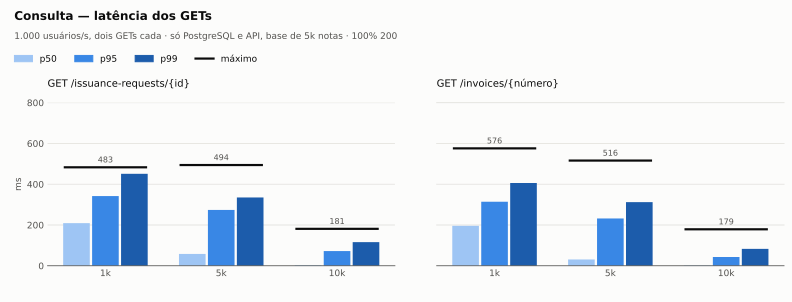

# API de Emissão de Nota Fiscal

API Kotlin/Spring Boot que recebe pedidos de emissão, calcula tributos e frete, gera a
nota fiscal com numeração única e notifica os sistemas de estoque, registro, entrega e
financeiro. O pedido é validado na hora e processado de forma **assíncrona**: a
solicitação e o evento de outbox são gravados juntos no PostgreSQL, os workers publicam
os eventos no Kafka, emitem a nota e notificam quatro consumidores independentes.

- [Premissas do projeto](#premissas-do-projeto)
  - [Do fluxo síncrono para o assíncrono](#do-fluxo-síncrono-para-o-assíncrono)
- [Problemas do enunciado e decisões da solução](#problemas-do-enunciado-e-decisões-da-solução)
- [Visão da solução](#visão-da-solução)
- [Arquitetura ideal em produção (AWS)](#arquitetura-ideal-em-produção-aws)
- [Contrato HTTP](#contrato-http)
  - [Documentação da API com Spring REST Docs](#documentação-da-api-com-spring-rest-docs)
- [Subir a aplicação completa](#subir-a-aplicação-completa)
- [Testar manualmente com curl](#testar-manualmente-com-curl)
- [Testes automatizados](#testes-automatizados)
- [Teste de carga local](#teste-de-carga-local)
- [Documentação relacionada](#documentação-relacionada)

## Premissas do projeto

### Projeto base não recebido

O enunciado do desafio ("Desafio Nota Fiscal - Kotlin") descreve uma aplicação legada
com estes problemas: itens de execuções anteriores se acumulam na resposta, pedidos com
mais de 6 itens demoram muito, a resposta fica mais lenta a cada execução, requisições
simultâneas são processadas uma de cada vez, os consumidores recebem centavos "sumindo"
ou "sobrando", há notas com numeração duplicada e dados incompletos geram `500` sem
explicação, ou notas sem itens ou sem frete.

**O repositório base desse legado não foi recebido.** Em resposta à solicitação feita à
recrutadora, foi informado que, por motivos de segurança, o projeto base não poderia ser
enviado e que o desafio poderia ser feito do zero com as informações disponíveis. Por
isso, o projeto foi implementado do zero, com estas premissas:

- **Contrato de entrada próprio.** O payload foi definido a partir dos termos do
  enunciado. Ele fica isolado nos DTOs de `app/.../entrypoint/model` (com `toDomain`), e
  as regras de cálculo só conhecem o domínio. Se um payload oficial for definido, muda
  apenas esse mapeamento.
- **Regras do enunciado como fonte da verdade.** Faixas de alíquota PF/PJ, acréscimo de
  frete por região, valores com 2 casas e arredondamento `HALF_EVEN` por item.
- **Premissas onde o enunciado é omisso:**
  - Um único endereço de entrega (`ENTREGA` ou
    `COBRANCA_ENTREGA`) define o frete;
  - Valores monetários negativos são rejeitados com
    `400`;
  - O modo de tributação é configurado (`nota-fiscal.tributacao.modo`, padrão
    `POR_FORA`) e nunca inferido do payload;
  - A fórmula de `POR_DENTRO` é uma premissa
    própria, explicada em [Modos de tributação](#modos-de-tributacao).
- **Autenticação fora da aplicação.** O API Gateway autentica o cliente e injeta
  `X-Client-Id`; a aplicação usa esse header para isolar os dados por cliente.

Os requisitos completos estão no [PRD](tasks/prd-emissao-nota-fiscal/prd.md) e na
[TechSpec](tasks/prd-emissao-nota-fiscal/techspec.md).

<a id="modos-de-tributacao"></a>

### Modos de tributação

O modo (`POR_FORA` ou `POR_DENTRO`) define se o valor informado nos itens já contém o
tributo. Ele vem da configuração `nota-fiscal.tributacao.modo`, vale para todas as notas
do processo e aparece na nota no campo `taxation_mode`. O payload nunca escolhe o modo.

| | `POR_FORA` (padrão) | `POR_DENTRO` |
|---|---|---|
| Valor informado nos itens | Líquido, sem o tributo | Bruto, já com o tributo embutido |
| Tributo por item | `round(item_total × alíquota, 2, HALF_EVEN)` | `round(item_total × alíquota / (1 + alíquota), 2, HALF_EVEN)` |
| O que o tributo faz | É **acrescentado** ao valor dos itens | É **extraído** do valor dos itens |
| Campo extra no item | — | `net_value = item_total − item_tax` |
| Total da nota | `items_total + tax + freight` | `items_total + freight` |

Nos dois modos, a alíquota é escolhida pela mesma tabela PF/PJ, a partir do total dos
itens como foi informado, e o tributo da nota é a soma dos tributos arredondados por item.

Exemplo com o pedido PF do [passo 4](#4-consultar-a-nota-e-conferir-os-valores) (itens
de 500,00 e 99,90, alíquota de 12% e frete de 31,44):

| Campo | `POR_FORA` | `POR_DENTRO` |
|---|---:|---:|
| Tributo do item de 500,00 | 60,00 (500,00 × 12%) | 53,57 (500,00 × 0,12 / 1,12) |
| Tributo do item de 99,90 | 11,99 | 10,70 |
| `totals.tax` | 71,99 | 64,27 |
| `totals.invoice_total` | 703,33 (599,90 + 71,99 + 31,44) | 631,34 (599,90 + 31,44) |

O enunciado não traz a fórmula de `POR_DENTRO`, e o projeto base não será enviado. A
fórmula acima é, portanto, uma premissa: o cálculo de "imposto por dentro" a partir de um
valor que já inclui o tributo. Ela fica isolada em uma estratégia do domínio
(`InclusiveTaxation`, ao lado de `ExclusiveTaxation`) e pode ser trocada sem afetar o
restante do fluxo.

### Do fluxo síncrono para o assíncrono

No fluxo síncrono descrito pelo enunciado, cada requisição esperava pelo cálculo, pela
numeração, pela gravação da nota e pela notificação de quatro sistemas. Como as
solicitações eram processadas uma de cada vez, uma etapa lenta aumentava a espera
da requisição atual e das seguintes. A solução separa o **aceite do pedido**, a
**emissão da nota** e a **entrega das notificações**.

| Aspecto | Legado (síncrono) | Solução (assíncrona) |
|---|---|---|
| Resposta do `POST` | Nota completa após a emissão e as notificações | `202 Accepted` após o registro, com id, `Location` e `Retry-After` |
| Tempo até a resposta | Cálculo, numeração, gravação e espera pelos quatro sistemas | Validação e gravação da solicitação com seu evento de outbox. Latência até o `202` em duas rodadas de 10.000 POSTs.<br>**Rodada 1:** P50 82 ms, P95 481 ms, P99 641 ms, máximo 799 ms.<br>**Rodada 2:** P50 12 ms, P95 168 ms, P99 318 ms, máximo 421 ms. [Resultados do POST isolado](docs/carga/relatorio.md#resultados-do-post-isolado) |
| Concorrência | Uma requisição por vez | API e worker escalam separadamente, com fila de gravação limitada por instância da API |
| Notificações | Executadas na própria requisição | Quatro grupos Kafka independentes, com retentativas e DLQ por grupo |
| Entrada inválida | `500` sem explicação ou geração de nota incompleta | `400` ou `422` com erros por campo, sem gravar a solicitação |
| Reenvio após falha de rede | Risco de emitir uma nota duplicada | Mesmo pedido com a mesma `Idempotency-Key` devolve a solicitação existente |

**O que foi implementado**

1. **Aceite na API.** O `POST /issuance-requests` valida o pedido e devolve
   `400` ou `422` com os erros por campo se houver uma rejeição de validação. Para
   um pedido novo e válido, a API grava a solicitação, a chave de idempotência e o
   evento de outbox na mesma transação do PostgreSQL. O `202 Accepted` sai após o
   commit, com o id da solicitação, `Location` e `Retry-After`. Repetir o mesmo
   pedido com a mesma chave devolve a solicitação existente.
2. **Emissão no worker.** O publicador lê os eventos pendentes no outbox e os envia
   ao Kafka. O worker consome a solicitação, calcula tributos e frete, reserva a
   numeração por série no banco e grava a nota. A mesma transação marca a solicitação
   como `EMITIDA` e grava o evento de nota emitida no outbox.
3. **Notificações independentes.** Estoque, registro, entrega e financeiro recebem
   o evento de nota emitida por grupos de consumidores separados. Cada grupo tem
   suas próprias retentativas e sua fila de mensagens com falha (DLQ), de modo que
   uma falha na entrega ao financeiro, por exemplo, pode ser tratada nesse grupo
   enquanto os demais continuam processando.

**O que se ganha com a separação**

- **Menos trabalho no caminho do POST.** O cliente espera pela validação e pela
  confirmação da gravação no PostgreSQL. O cálculo, a numeração e a latência dos
  quatro consumidores ficam fora do tempo de resposta HTTP.
- **Aceite preservado durante falhas de publicação.** Se a publicação no Kafka
  falhar, o evento fica pendente no outbox para uma nova tentativa. O pedido aceito
  já está registrado no banco e pode ser processado quando o fluxo for retomado.
- **Escala independente e proteção do banco.** A API e o worker podem ganhar
  réplicas conforme a demanda de entrada e o volume pendente de emissão. Cada
  instância da API usa uma fila de gravação limitada e poucos escritores em lote
  para absorver rajadas. Quando a fila está cheia, a API devolve `503` com
  `Retry-After`.

Na melhor das duas rodadas locais de **10.000 POSTs** (a de menor p95), com o worker
parado, todos os pedidos receberam `202`. A carga oferecida foi de **1.000 POST/s** e
a vazão medida foi de **1.000 POST/s**, com latência p95 de **168 ms** e máximo de
**421 ms**. Esses tempos medem o aceite HTTP. Em um cenário separado, a partir da
retomada do worker, a emissão das 10.000 notas levou **18 s** e a conclusão das 40.000
notificações levou **57 s**.
Os números servem como referência da capacidade medida para a solução atual.
[Resultados do POST isolado](docs/carga/relatorio.md#resultados-do-post-isolado) ·
[Resultados do consumo isolado](docs/carga/relatorio.md#resultados-do-consumo-isolado)

**O que muda para quem integra**

1. O `202` confirma o registro da solicitação. O cliente usa a URL do `Location`
   e respeita o `Retry-After` ao consultar `GET /issuance-requests/{id}` enquanto
   o estado for `RECEBIDA` ou `PROCESSANDO`. A consulta pode mostrar um estado
   anterior por alguns instantes. Para ids recentes ainda ausentes na réplica,
   a API pode consultar a primária e evitar um `404` falso logo após o aceite.
2. Em `EMITIDA`, o cliente segue `links.invoice` para consultar a nota completa,
   que oferece `ETag`. Em `FALHA`, a resposta informa o motivo.
3. Após um timeout ou um `503`, o cliente reenvia o mesmo pedido com a mesma
   `Idempotency-Key`.

## Problemas do enunciado e decisões da solução

### Código difícil de manter e alterar

A solução aplica princípios de SOLID, Clean Code, DDD e Clean Architecture para deixar
as regras fáceis de localizar e alterar. O módulo `domain` usa termos do negócio, como
pedido, alíquota e nota fiscal, em modelos e casos de uso que podem ser testados sem
subir o Spring. O módulo `app` adapta HTTP, PostgreSQL e Kafka às interfaces do domínio.
Uma mudança no formato do pedido começa nos DTOs e no mapeamento de entrada. Uma mudança
na faixa de alíquota começa na tabela fiscal do domínio e nos testes dos seus limites.

### Muitas regras de cálculo e fluxo complexo

O princípio da responsabilidade única (SRP) orienta a divisão do cálculo. A
`DefaultTaxRateTable` seleciona a alíquota por faixa, tipo de pessoa e regime fiscal.
A `FreightTable` aplica o acréscimo da região de entrega. `ExclusiveTaxation` e
`InclusiveTaxation` calculam o tributo de cada item nos modos `POR_FORA` e `POR_DENTRO`.
O [`CalculateInvoice`](domain/src/main/kotlin/com/itau/desafio_diogo_bernard/usecase/calculo/CalculateInvoice.kt)
coordena essas regras e consolida os totais. O tipo `Money` representa valores com
`BigDecimal`, escala 2 e arredondamento `HALF_EVEN`. O fluxo de emissão também tem
etapas distintas de recebimento, processamento e notificação, como mostra o [diagrama
da solução](#visão-da-solução).

As faixas e os percentuais fixos do enunciado ficam versionados no código e podem ser
testados sem banco. Alterá-los exige publicar uma nova versão da aplicação. Se as
tabelas precisassem mudar sem deploy, faria sentido armazená-las no PostgreSQL com
vigência e histórico, de forma que cada emissão pudesse identificar a versão das
regras aplicadas.

### Classe principal instável

`Application.kt` apenas inicializa o Spring Boot. O `RequestIssuanceUseCase` cuida do
registro idempotente da solicitação. O `ProcessIssuanceRequestUseCase` inicia o
processamento, chama o cálculo e delega a gravação da nota ao adaptador de persistência.
Cada cálculo monta seus itens e totals a partir do pedido atual, sem estado mutável
compartilhado entre execuções. Assim, uma solicitação pode ser processada em paralelo
com outra sem misturar os itens das duas.

### Baixa cobertura e testes pouco confiáveis

Os testes conferem resultados esperados a partir das regras do enunciado. Por exemplo,
o [`CalculateInvoiceTest`](domain/src/test/kotlin/com/itau/desafio_diogo_bernard/usecase/calculo/CalculateInvoiceTest.kt)
verifica que dois itens de R$ 0,50, tributados a 3%, geram R$ 0,02 de tributo por item e
R$ 0,04 no total. Os testes de integração usam PostgreSQL e Kafka para verificar
comportamentos como o rollback da numeração e o isolamento de falhas entre consumidores.
Os testes com MockMvc também verificam o contrato HTTP e geram os exemplos da
[documentação da API](#documentação-da-api-com-spring-rest-docs).
Os testes E2E exercitam a jornada HTTP do pedido à consulta da nota. Os testes de carga
medem a latência e a capacidade de processamento no ambiente descrito no [relatório
de carga](docs/carga/relatorio.md).

O CI executa o `koverVerify` e exige 100% de linhas e ramificações no escopo medido de
cada módulo. A cobertura do `domain` vem dos testes unitários. No `app`, o Kover agrega
os testes unitários e de integração. A execução registrada atingiu 100% nos dois
módulos. [Evidências de QA](tasks/prd-emissao-nota-fiscal/evidences/validacao-automatizada.md).

## Visão da solução



- **Módulos Gradle:** `domain` (modelos, validações, cálculo, numeração e casos de uso,
  sem Spring) e `app` (HTTP, PostgreSQL, Kafka e observabilidade). A dependência é
  `app → domain`.
- **Um artefato, dois papéis de runtime:** `APP_RUNTIME_ROLE=api` atende HTTP;
  `APP_RUNTIME_ROLE=worker` executa o polling do outbox, a emissão e os consumidores.
  `combined` (padrão fora do Compose) faz os dois e é usado pelos testes.
- **Leituras:** podem ir a uma réplica do PostgreSQL, com fallback filtrado para a
  primária só para ids recentes, o que evita `404` falso sem abrir a primária para
  varredura de ids antigos.
- Decisões detalhadas em [`docs/adr/`](docs/adr/README.md).

## Arquitetura ideal em produção (AWS)

O ambiente local reproduz a lógica da solução, mas não a topologia de produção. O
desenho proposto para a AWS, detalhado em [docs/arquitetura.md](docs/arquitetura.md) e
[docs/deploy.md](docs/deploy.md), separa cada responsabilidade em infraestrutura própria:



| Aspecto | Produção (AWS) | Ambiente local (Compose) |
|---|---|---|
| Borda e autenticação | API Gateway com OAuth2 client credentials (Cognito), JWT com scopes e rate limit por cliente; aplicação acessível só pelo VPC Link | Sem gateway; `X-Client-Id` enviado diretamente |
| API e worker | Serviços separados em ECS Fargate ou EKS, em várias zonas, escalados de forma independente (API pela demanda HTTP; worker pelo backlog do outbox e lag do Kafka) | Um contêiner de cada, com 2 CPUs e 2 GiB, no mesmo host |
| Banco | Aurora/RDS PostgreSQL Multi-AZ, com read replica ou reader endpoint para os GETs | PostgreSQL 17 em contêiner; réplica opcional no mesmo host |
| Mensageria | Amazon MSK com replicação 3, `min.insync.replicas=2` e autenticação IAM | Um broker Kafka KRaft, replicação 1 |
| Sistemas consumidores | Sistemas reais, cada um com seu consumer group e DLQ | Simulados no worker, com latência artificial de 50 a 300 ms |
| Observabilidade | ADOT Collector → CloudWatch e X-Ray | Actuator com Prometheus na API (8081) e no worker (8082) e logs JSON |
| Segredos | Secrets Manager / Parameter Store com IAM | `.env` local, fora do Git |
| Deploy | Imagem imutável por commit, blue/green ou canary, migrations Flyway em expand/contract | `docker compose up --build` |
| Evolução | CDC (Debezium/MSK Connect) no lugar do polling do outbox, se a latência ou o custo justificarem | Polling do outbox |

Em produção, a capacidade cresce horizontalmente: mais tasks de API absorvem rajadas de
`POST`, mais tasks de worker (até o número de partições) aceleram a emissão, e os GETs
saem da primária para a réplica. Os orçamentos de conexões Hikari devem ser
dimensionados por papel e pelo número de réplicas, dentro do limite do banco.

## Contrato HTTP

Todos os endpoints de negócio exigem `X-Client-Id`. O `POST` também exige
`Idempotency-Key` como UUID. Os erros usam `application/problem+json` (RFC 9457), com a
lista `errors` por campo.

| Método e rota | Resultado |
|---|---|
| `POST /issuance-requests` | `202 Accepted`, `Location` e `Retry-After` |
| `GET /issuance-requests/{id}` | `200 OK` com estado, datas e links; `Retry-After` enquanto `RECEBIDA`/`PROCESSANDO`; header `Link` para a nota quando `EMITIDA` |
| `GET /invoices/{number}?series=1` | `200 OK` com `ETag` e `Cache-Control: private`; `304` quando `If-None-Match` corresponde |

| Status | Quando ocorre |
|---|---|
| `400` | JSON malformado; campo obrigatório ausente; pedido sem itens ou sem endereço de entrega; PJ sem regime; quantidade não inteira ou ≤ 0; valor negativo; documento inválido; `Idempotency-Key` ausente ou não UUID |
| `401` | `X-Client-Id` ausente (fora do gateway) |
| `404` | Solicitação ou nota inexistente, ou de outro cliente |
| `422` | PJ com regime `OUTROS`; mais de 500 itens; `Idempotency-Key` reutilizada com outro pedido |
| `503` | Fila de gravação da instância cheia ou prazo de espera excedido; repita com a mesma `Idempotency-Key` após o `Retry-After` |

Campos do pedido: `recipient` (`person_type` `FISICA`/`JURIDICA`, `document` CPF ou
CNPJ só com dígitos e dígitos verificadores válidos, `tax_regime`
`SIMPLES_NACIONAL`/`LUCRO_REAL`/`LUCRO_PRESUMIDO`/`OUTROS` para PJ), `items`
(`code`, `description`, `unit_price`, `quantity`), `freight_value` e `addresses`
(`purpose` `ENTREGA`/`COBRANCA`/`COBRANCA_ENTREGA`, `region`
`NORTE`/`NORDESTE`/`CENTRO_OESTE`/`SUDESTE`/`SUL`). A API mascara o documento nas
respostas de nota.

### Documentação da API com Spring REST Docs

O **Spring REST Docs** gera exemplos de requisições e respostas a partir dos testes
com MockMvc. O guia cobre a solicitação de emissão e as consultas de solicitação e de
nota fiscal, com campos, parâmetros, cabeçalhos e exemplos de erro. Os testes verificam
se os campos documentados correspondem aos payloads exercitados.

Para gerar o guia localmente, execute na raiz do projeto com o JDK 21.

```bash
./gradlew :app:asciidoctor
```

A tarefa usa a suíte de testes do `app` para gerar os exemplos e o Asciidoctor para
montar o HTML. O guia é gerado sem subir a API ou o Docker.

[Abrir a documentação da API no navegador](app/build/docs/asciidoc/index.html) ·
[Fonte do guia](app/src/docs/asciidoc/index.adoc)

## Subir a aplicação completa

### Pré-requisitos

- Docker com Docker Compose v2 (comando `docker compose`).
- `curl`; `jq` é opcional e simplifica os exemplos de teste manual.
- JDK 21 apenas para rodar o Gradle fora do Docker (o Wrapper fixa a versão do Gradle).
- Portas livres: `8080` (API), `8081` (actuator da API), `8082` (actuator do worker),
  `5432` (PostgreSQL), `9092` (Kafka) e, com a réplica, `5433`.

### Com o script (recomendado)

```bash
bash scripts/subir-ambiente.sh                         # PostgreSQL, Kafka, API e worker
bash scripts/subir-ambiente.sh --verificar             # sobe e emite uma nota de teste de ponta a ponta
bash scripts/subir-ambiente.sh --replica --verificar   # inclui a réplica de leitura do PostgreSQL
bash scripts/subir-ambiente.sh --sem-build             # reaproveita a imagem já construída
bash scripts/subir-ambiente.sh --parar                 # encerra e mantém os dados
bash scripts/subir-ambiente.sh --limpar                # encerra e apaga o volume do banco
```

O script:

1. confere Docker, Compose e `curl`;
2. cria o `.env` a partir do `.env.example`, se ele não existir, com senhas locais
   aleatórias (o `.env` é ignorado pelo Git e as senhas nunca são impressas). Se o
   `.env` já existir, valida que `DB_PASSWORD` e `REPLICATION_PASSWORD` não estão vazios
   nem com placeholder;
3. sobe PostgreSQL e Kafka e espera os health checks (com `--replica`, também a réplica,
   apontando `DB_READ_URL` para ela);
4. constrói a imagem e sobe a API e o worker;
5. espera o readiness da API (`http://localhost:8081/actuator/health/readiness`) e do
   worker (`http://localhost:8082/actuator/health/readiness`) responder `UP`;
6. com `--verificar`, envia um pedido fictício, acompanha até `EMITIDA` e imprime a nota.

O primeiro build da imagem compila o projeto com Gradle dentro do Docker e leva alguns
minutos. `SUBIR_TIMEOUT_S` (padrão 240) limita a espera pelo readiness de cada processo.

> O volume `postgres-data` guarda a senha usada na criação do banco. Se você apagar o
> `.env`, restaure a mesma senha ou recrie o banco com `--limpar`; o script avisa quando
> encontra o volume sem `.env`.

### Passo a passo com Docker Compose

```bash
cp .env.example .env
# Edite o .env: DB_PASSWORD=<DB_PASSWORD_FICTICIA> e REPLICATION_PASSWORD=<REPLICATION_PASSWORD_FICTICIA>
docker compose up --build -d
curl -s http://localhost:8081/actuator/health/readiness   # API: aguarde {"status":"UP"}
curl -s http://localhost:8082/actuator/health/readiness   # worker: aguarde {"status":"UP"}
```

Para usar a réplica de leitura, defina no `.env`
`DB_READ_URL=jdbc:postgresql://postgres-replica:5432/notafiscal?currentSchema=notafiscal`
e suba com `docker compose --profile replica up --build -d`. A réplica tem os mesmos
limites da primária (2 CPUs e 1 GiB). Para encerrar, use
`docker compose --profile replica down` (acrescente `-v` para apagar os dados).

Acompanhe os logs com `docker compose logs -f api worker`.

### Endereços

| Serviço | Endereço |
|---|---|
| API | `http://localhost:8080` |
| Actuator da API | `http://localhost:8081/actuator/health/liveness`, `/actuator/health/readiness` e `/actuator/prometheus` |
| Actuator do worker | `http://localhost:8082/actuator/health/liveness`, `/actuator/health/readiness` e `/actuator/prometheus` |
| PostgreSQL primária | `localhost:5432`, banco e usuário `notafiscal`, schema `notafiscal`, senha do `.env` |
| PostgreSQL réplica | `localhost:5433` (só com `--replica`) |
| Kafka | `localhost:9092` (na rede do Compose: `kafka:29092`) |

Cada processo expõe o actuator na própria porta de gerenciamento
(`MANAGEMENT_SERVER_PORT=8081` dentro do contêiner), separada do tráfego de negócio para
continuar respondendo sob carga; esses caminhos não existem na porta `8080`. O worker não
atende rotas de negócio: o servlet dele existe só para o actuator, publicado em `8082`.
A readiness dos dois verifica o banco primário e o Kafka.

### Configuração do ambiente local

No Compose, API e worker são processos separados do mesmo artefato, com limites de
2 CPUs e 2 GiB cada. Cada instância da API recebe os `POST` numa fila limitada em
memória, consumida por escritores que gravam as solicitações em lotes; cada requisição
continua individual e só recebe `202` depois do commit. Os valores podem ser ajustados
por variável de ambiente (no `.env` ou no shell):

| Variável | Padrão | Uso |
|---|---|---|
| `API_DB_WRITE_POOL_SIZE` / `API_DB_READ_POOL_SIZE` | 25 / 25 | Pools Hikari da API |
| `WORKER_DB_WRITE_POOL_SIZE` / `WORKER_DB_READ_POOL_SIZE` | 5 / 10 | Pools Hikari do worker (mantenha a soma dentro do limite do banco: 30 escrita / 35 leitura) |
| `API_DB_WRITE_CONNECTION_TIMEOUT` | `10s` | Espera máxima por uma conexão de escrita |
| `NOTA_FISCAL_INGRESSO_CAPACIDADE` | 1000 | Tamanho da fila de `POST` por instância |
| `NOTA_FISCAL_INGRESSO_ESPERA_MAXIMA` | `8s` | Espera na fila antes do `503` |
| `NOTA_FISCAL_INGRESSO_LOTE_MAXIMO` | 100 | Solicitações por comando de gravação |
| `NOTA_FISCAL_INGRESSO_ESCRITORES` | 2 | Escritores que consomem a fila |
| `SERVER_TOMCAT_MAX_CONNECTIONS` | 8192 | Conexões simultâneas do Tomcat |
| `SERVER_TOMCAT_ACCEPT_COUNT` | 100 | Fila de conexões pendentes do socket |
| `MANAGEMENT_TRACING_SAMPLING_PROBABILITY` | `1.0` | Amostragem de traces |
| `LOCAL_CONSUMER_CONCURRENCY` | 10 | Concorrência dos listeners e notificações em voo por consumidor |
| `DB_READ_URL` | primária | Datasource de leitura (réplica com `--profile replica`) |

Para executar a aplicação fora do Compose, `APP_RUNTIME_ROLE` aceita `api`, `worker` ou
`combined`.

## Testar manualmente com curl

Suba o ambiente (`bash scripts/subir-ambiente.sh`). Os comandos abaixo não usam
variáveis de shell: cole-os no terminal ou importe no Postman (**Import → Raw text**) e
edite os valores. Os documentos são fictícios, gerados apenas com dígitos verificadores
válidos.

| Valor nos exemplos | O que é e quando trocar |
|---|---|
| `X-Client-Id: cliente-local` | Identificador do cliente; qualquer texto. Os dados de um cliente não aparecem para outro |
| `Idempotency-Key: 3f6c2a1e-...` | Um UUID por pedido. A mesma chave com o mesmo pedido devolve a mesma solicitação; com outro pedido, `422`. Para criar uma solicitação nova, troque a chave |
| `019a9a2e-6f3c-7b51-9d2e-4b8f0c1a2d3e` | Troque pelo `id` devolvido no `POST` |
| `/invoices/1?series=1` | Troque pelo `links.invoice` devolvido quando a solicitação fica `EMITIDA` |

### 1. Solicitar a emissão (pessoa física)

```bash
curl -i 'http://localhost:8080/issuance-requests' \
  -H 'Content-Type: application/json' \
  -H 'X-Client-Id: cliente-local' \
  -H 'Idempotency-Key: 3f6c2a1e-8b4d-4c7a-9e21-5d0b7f9a1c01' \
  -d '{
    "recipient": {
      "person_type": "FISICA",
      "document": "52998224725"
    },
    "items": [
      {
        "code": "SKU-001",
        "description": "Teclado",
        "unit_price": 250.00,
        "quantity": 2
      },
      {
        "code": "SKU-002",
        "description": "Mouse",
        "unit_price": 99.90,
        "quantity": 1
      }
    ],
    "freight_value": 30.00,
    "addresses": [
      {
        "purpose": "ENTREGA",
        "region": "SUDESTE"
      }
    ]
  }'
```

```http
HTTP/1.1 202
Location: /issuance-requests/019a9a2e-6f3c-7b51-9d2e-4b8f0c1a2d3e
Retry-After: 1
Content-Type: application/json

{"id":"019a9a2e-6f3c-7b51-9d2e-4b8f0c1a2d3e","status":"RECEBIDA","received_at":"...","updated_at":"...","links":{"self":"/issuance-requests/019a9a2e-6f3c-7b51-9d2e-4b8f0c1a2d3e"}}
```

Guarde o `id` da resposta: ele é usado nos próximos passos.

### 2. Repetir com a mesma chave (idempotência)

Envie de novo exatamente o comando do passo 1. A resposta é `202` com **o mesmo id**,
sem criar outra solicitação. Manter a chave e mudar o corpo gera `422` (passo 7).

### 3. Acompanhar o estado até `EMITIDA`

```bash
curl -i 'http://localhost:8080/issuance-requests/019a9a2e-6f3c-7b51-9d2e-4b8f0c1a2d3e' \
  -H 'X-Client-Id: cliente-local'
```

Enquanto a solicitação está `RECEBIDA` ou `PROCESSANDO`, a resposta traz `Retry-After`:
repita a chamada depois desse intervalo (localmente, a emissão costuma terminar em menos
de um segundo). Depois da emissão:

```http
HTTP/1.1 200
Link: </invoices/1?series=1>; rel="invoice"
Content-Type: application/json

{"id":"019a9a2e-...","status":"EMITIDA","received_at":"...","updated_at":"...","invoice":{"number":1,"series":1,"issued_at":"..."},"links":{"self":"/issuance-requests/019a9a2e-...","invoice":"/invoices/1?series=1"}}
```

### 4. Consultar a nota e conferir os valores

Use o caminho de `links.invoice` (o número depende de quantas notas já foram emitidas):

```bash
curl -i 'http://localhost:8080/invoices/1?series=1' \
  -H 'X-Client-Id: cliente-local'
```

A resposta traz `ETag` e `Cache-Control: max-age=86400, private, immutable`. Valores
esperados para o pedido PF do passo 1 (total dos itens 599,90 → alíquota PF de 12%;
frete SUDESTE com acréscimo de 4,8%):

| Campo | Valor | Conta |
|---|---:|---|
| `totals.items_total` | 599,90 | 250,00 × 2 + 99,90 × 1 |
| `items[].item_tax` | 60,00 e 11,99 | 500,00 × 12% e 99,90 × 12% = 11,988 → `HALF_EVEN` |
| `totals.tax` | 71,99 | soma dos tributos por item |
| `freight.total` | 31,44 | 30,00 + 30,00 × 4,8% |
| `totals.invoice_total` | 703,33 | 599,90 + 71,99 + 31,44 |

### 5. Cache com `ETag` (`304`)

Copie o valor do header `ETag` da resposta do passo 4, com as aspas:

```bash
curl -i 'http://localhost:8080/invoices/1?series=1' \
  -H 'X-Client-Id: cliente-local' \
  -H 'If-None-Match: "1-1"'
```

A resposta é `HTTP/1.1 304`, sem corpo.

### 6. Pessoa jurídica

```bash
curl -i 'http://localhost:8080/issuance-requests' \
  -H 'Content-Type: application/json' \
  -H 'X-Client-Id: cliente-local' \
  -H 'Idempotency-Key: 3f6c2a1e-8b4d-4c7a-9e21-5d0b7f9a1c02' \
  -d '{
    "recipient": {
      "person_type": "JURIDICA",
      "document": "11222333000181",
      "tax_regime": "LUCRO_PRESUMIDO"
    },
    "items": [
      {
        "code": "SKU-100",
        "description": "Monitor",
        "unit_price": 1500.00,
        "quantity": 1
      }
    ],
    "freight_value": 50.00,
    "addresses": [
      {
        "purpose": "COBRANCA",
        "region": "SUL"
      },
      {
        "purpose": "ENTREGA",
        "region": "NORDESTE"
      }
    ]
  }'
```

Acompanhe pelos passos 3 e 4 com o `id` devolvido. Esperado na nota: alíquota de 9%
(Lucro Presumido, faixa de 1.000,00 a 2.000,00), tributo 135,00, frete 54,25 (só o
endereço de entrega, NORDESTE, entra no cálculo: 50,00 + 8,5%) e total 1.689,25.

### 7. Erros de validação e de contrato

**422: mesma chave do passo 1 com outro pedido**

```bash
curl -i 'http://localhost:8080/issuance-requests' \
  -H 'Content-Type: application/json' \
  -H 'X-Client-Id: cliente-local' \
  -H 'Idempotency-Key: 3f6c2a1e-8b4d-4c7a-9e21-5d0b7f9a1c01' \
  -d '{
    "recipient": {
      "person_type": "FISICA",
      "document": "52998224725"
    },
    "items": [
      {
        "code": "SKU-001",
        "description": "Teclado",
        "unit_price": 250.00,
        "quantity": 5
      }
    ],
    "freight_value": 30.00,
    "addresses": [
      {
        "purpose": "ENTREGA",
        "region": "SUDESTE"
      }
    ]
  }'
```

**400: pedido sem itens (erro por campo em `errors`)**

```bash
curl -i 'http://localhost:8080/issuance-requests' \
  -H 'Content-Type: application/json' \
  -H 'X-Client-Id: cliente-local' \
  -H 'Idempotency-Key: 3f6c2a1e-8b4d-4c7a-9e21-5d0b7f9a1c03' \
  -d '{
    "recipient": {
      "person_type": "FISICA",
      "document": "52998224725"
    },
    "freight_value": 10.00,
    "addresses": [
      {
        "purpose": "ENTREGA",
        "region": "SUL"
      }
    ]
  }'
```

**400: `Idempotency-Key` ausente**

```bash
curl -i 'http://localhost:8080/issuance-requests' \
  -H 'Content-Type: application/json' \
  -H 'X-Client-Id: cliente-local' \
  -d '{
    "recipient": {
      "person_type": "FISICA",
      "document": "52998224725"
    },
    "items": [
      {
        "code": "SKU-001",
        "description": "Teclado",
        "unit_price": 250.00,
        "quantity": 2
      }
    ],
    "freight_value": 30.00,
    "addresses": [
      {
        "purpose": "ENTREGA",
        "region": "SUDESTE"
      }
    ]
  }'
```

**400: JSON malformado**

```bash
curl -i 'http://localhost:8080/issuance-requests' \
  -H 'Content-Type: application/json' \
  -H 'X-Client-Id: cliente-local' \
  -H 'Idempotency-Key: 3f6c2a1e-8b4d-4c7a-9e21-5d0b7f9a1c04' \
  -d '{"items": ['
```

**422: PJ com regime `OUTROS`**

```bash
curl -i 'http://localhost:8080/issuance-requests' \
  -H 'Content-Type: application/json' \
  -H 'X-Client-Id: cliente-local' \
  -H 'Idempotency-Key: 3f6c2a1e-8b4d-4c7a-9e21-5d0b7f9a1c05' \
  -d '{
    "recipient": {
      "person_type": "JURIDICA",
      "document": "11222333000181",
      "tax_regime": "OUTROS"
    },
    "items": [
      {
        "code": "SKU-100",
        "description": "Monitor",
        "unit_price": 1500.00,
        "quantity": 1
      }
    ],
    "freight_value": 50.00,
    "addresses": [
      {
        "purpose": "ENTREGA",
        "region": "NORDESTE"
      }
    ]
  }'
```

**422: mais de 500 itens**

O corpo com 501 itens é grande demais para copiar à mão. Gere o arquivo com `jq` e envie;
no Postman, cole o conteúdo do arquivo em **Body → raw → JSON**:

```bash
jq -n '{
  recipient: { person_type: "FISICA", document: "52998224725" },
  items: [range(501) | { code: "SKU-\(.)", description: "Item", unit_price: 1.00, quantity: 1 }],
  freight_value: 30.00,
  addresses: [{ purpose: "ENTREGA", region: "SUDESTE" }]
}' > pedido-501-itens.json

curl -i 'http://localhost:8080/issuance-requests' \
  -H 'Content-Type: application/json' \
  -H 'X-Client-Id: cliente-local' \
  -H 'Idempotency-Key: 3f6c2a1e-8b4d-4c7a-9e21-5d0b7f9a1c06' \
  --data @pedido-501-itens.json
```

**401: sem `X-Client-Id`**

```bash
curl -i 'http://localhost:8080/issuance-requests/019a9a2e-6f3c-7b51-9d2e-4b8f0c1a2d3e'
```

**404: solicitação e nota de outro cliente (isolamento por cliente)**

```bash
curl -i 'http://localhost:8080/issuance-requests/019a9a2e-6f3c-7b51-9d2e-4b8f0c1a2d3e' \
  -H 'X-Client-Id: outro-cliente'
```

```bash
curl -i 'http://localhost:8080/invoices/1?series=1' \
  -H 'X-Client-Id: outro-cliente'
```

**404: solicitação inexistente**

```bash
curl -i 'http://localhost:8080/issuance-requests/00000000-0000-0000-0000-000000000000' \
  -H 'X-Client-Id: cliente-local'
```

### 8. Observar o processamento assíncrono por dentro

```bash
# As quatro notificações da nota (estoque, registro, entrega e financeiro)
docker compose exec postgres psql -U notafiscal -d notafiscal -c \
  "SELECT consumidor, serie, numero, entregas FROM notafiscal.notificacao_recebida ORDER BY recebida_em DESC LIMIT 8;"

# Evento NotaEmitida publicado no Kafka
docker compose exec kafka /opt/kafka/bin/kafka-console-consumer.sh \
  --bootstrap-server localhost:9092 --topic notafiscal.notas.v1 --from-beginning --max-messages 1

# Métricas de negócio da API: solicitações recebidas, fila de ingresso, lag da réplica,
# fallbacks de leitura e 404 falso
curl -s http://localhost:8081/actuator/prometheus | grep '^notafiscal_'

# Métricas de negócio do worker: notas emitidas, duração da emissão, espera pela numeração,
# outbox pendente, atraso de cada consumidor e envios para DLQ (este contador só aparece
# depois do primeiro envio)
curl -s http://localhost:8082/actuator/prometheus | grep '^notafiscal_'

# Métricas técnicas: pools Hikari e JVM nos dois processos, requisições HTTP na API,
# listeners e lag dos consumidores Kafka no worker
curl -s http://localhost:8081/actuator/prometheus | grep -E '^(hikaricp_connections_active|http_server_requests_seconds_count)'
curl -s http://localhost:8082/actuator/prometheus | grep -E '^(hikaricp_connections_active|spring_kafka_listener_seconds_count|kafka_consumer_fetch_manager_records_lag_max)'

# Logs estruturados dos dois processos
docker compose logs -f api worker
```

Os mesmos cenários também existem como arquivos `.http` (IntelliJ HTTP Client ou REST
Client do VS Code) em [`docs/exemplos/`](docs/exemplos/), descritos em
[MANUAL-TESTES.md](MANUAL-TESTES.md).

## Testes automatizados

| Suíte | Comando | Código | Docker | O que valida |
|---|---|---|---|---|
| Unitários do `domain` | `./gradlew :domain:test` | `domain/src/test` | Não | Faixas de alíquota e seus limites, `HALF_EVEN`, soma das linhas igual ao total, `POR_FORA`/`POR_DENTRO`, validações e casos de uso |
| Unitários do `app` e REST Docs | `./gradlew :app:test` | `app/src/test` | Não | Controllers (MockMvc), handlers de erro, DTOs, jobs, consumidores com fakes; gera os snippets da documentação |
| Integração | `./gradlew :app:integrationTest` | `app/src/integration` | Sim | PostgreSQL 17 e Kafka via Testcontainers: outbox atômico, numeração concorrente sem duplicidade nem lacunas, idempotência, retries e DLQs, réplica e fallback, observabilidade |
| E2E | `./gradlew :app:e2eTest` | `app/src/e2e` | Sim | Jornadas HTTP completas: PF, PJ por regime, `POR_DENTRO`, idempotência, consulta imediata sem `404`, 500/501 itens e notificação dos 4 consumidores |
| Smoke do Compose | `bash scripts/smoke-e2e.sh` | `scripts/` | Sim | Ambiente Compose isolado (portas livres), com API e worker separados emitindo uma nota, notificando os 4 consumidores e expondo métricas Prometheus |
| Carga | `./gradlew :app:loadTest` | `app/src/gatling`, `scripts/carga*.sh` | Sim | Ver [Teste de carga local](#teste-de-carga-local) |
| Cobertura | `./gradlew koverHtmlReport koverVerify` | — | Sim | 100% de linhas e branches por módulo; no `app`, soma unitários e integração |
| Análise estática | `./gradlew detekt ktlintCheck` | — | Não | Regras do detekt (baseline em `*/detekt-baseline.xml`) e formatação ktlint (`./gradlew ktlintFormat` corrige) |

`./gradlew test` roda os unitários dos dois módulos; as tarefas `integrationTest`,
`e2eTest` e `loadTest` selecionam os testes pelas tags JUnit correspondentes. Os testes
de integração e E2E sobem PostgreSQL e Kafka descartáveis e não dependem do ambiente do
Compose.

### Executar uma classe ou um teste específico

```bash
# Uma classe
./gradlew :domain:test --tests 'com.itau.desafio_diogo_bernard.usecase.calculo.CalculateInvoiceTest'

# Um único teste (o nome entre crases do Kotlin, com espaços)
./gradlew :domain:test --tests 'com.itau.desafio_diogo_bernard.usecase.calculo.CalculateInvoiceTest.calcula total da nota por fora'

# Curingas
./gradlew :app:test --tests '*IssuanceRequestController*'
./gradlew :app:integrationTest --tests '*NumberingRollbackIntegrationTest'
./gradlew :app:e2eTest --tests '*InvoiceIssuanceE2ETest.reenvio com a mesma chave*'

# Forçar a reexecução quando o Gradle considerar a tarefa atualizada
./gradlew :domain:test --rerun
```

### Relatórios

| Relatório | Caminho |
|---|---|
| Testes (por tarefa) | `<módulo>/build/reports/tests/<tarefa>/index.html`, por exemplo `app/build/reports/tests/integrationTest/index.html` |
| Cobertura Kover | `<módulo>/build/reports/kover/html/index.html` |
| Documentação da API | `app/build/docs/asciidoc/index.html` |
| Carga (Gatling e coletas) | `app/build/reports/gatling/` e `app/build/reports/load/` |

### Validação completa, como no CI

```bash
./gradlew build -x koverVerify
./gradlew test :app:integrationTest :app:e2eTest detekt ktlintCheck koverHtmlReport
bash scripts/smoke-e2e.sh
./gradlew koverVerify
```

O workflow `.github/workflows/ci.yml` executa essa sequência a cada push e pull request;
a carga roda manualmente ou no agendamento semanal.

## Teste de carga local

### Por que o teste foi segregado por serviço

O PRD pede rodadas de 1.000, 5.000 e 10.000 solicitações a 1.000 req/s. Localmente,
**todos os componentes dividem a mesma máquina**: o gerador Gatling, a API, o worker, a
primária e a réplica do PostgreSQL, o Kafka e os coletores rodam no Docker Desktop do
mesmo Mac (8 CPUs para o Docker). Em produção, cada um teria recursos próprios.

As rodadas combinadas (POST + GET imediato + emissão + notificações ao mesmo tempo)
mostraram que, nessas condições, o resultado media mais a disputa por CPU do host do
que a aplicação:

- nas rodadas com a API limitada a 2 CPUs, a latência do `POST` acompanhava o uso
  de CPU. Os lotes de gravação levavam dezenas de milissegundos e usavam até 2 conexões;
- com o host ocupado (load average de 15 a 20), as mesmas configurações que passavam
  falhavam, com `POST` máximo de 15 a 25 s;
- duas rodadas combinadas de 10k com configuração idêntica tiveram `GET` p50 de 33,9 s e
  de 8,7 s, e uma delas teve 97 respostas `500` por espera de conexão de leitura.

Por essa limitação computacional local, a carga foi **segregada por serviço**, na ordem
`POST` → consumo → consulta, imitando o isolamento que API e worker teriam em produção:
em cada cenário, só o serviço medido recebe tráfego e os demais ficam parados. No perfil
de carga, a API usa 4 CPUs em todos os cenários e o worker usa 4 no consumo e no
combinado (`LOAD_INSTANCIA_CPUS`, limitado às CPUs do Docker). No Compose de referência,
a API usa 4 CPUs e o worker usa 2. O combinado usa 1.000 solicitações para validar o
fluxo completo e os fallbacks de leitura.

| Cenário | Comando | O que mede | O que fica parado | Volumes | Critério |
|---|---|---|---|---|---|
| `post` | `./gradlew :app:loadTest -PloadScenario=post` | Ingresso: `POST` até o commit da solicitação e do outbox | Worker | 1k, 5k e 10k, duas rodadas, após aquecer com 3.000 `POST` | 100% aceito e nenhum `POST` acima de 3 s (`LOAD_POST_MAX_MS`); um evento de outbox por solicitação |
| `consumo` | `./gradlew :app:loadTest -PloadScenario=consumo` | Worker: outbox → Kafka → emissão → 4 notificações, a partir de um backlog criado com o worker pausado | Tráfego HTTP durante a medição (a API só monta o backlog antes) | 1k, 5k e 10k, após backlog de aquecimento de 3.000 | Todas emitidas e notificadas, sem duplicidade, lacunas ou mensagens em DLQ |
| `consulta` | `./gradlew :app:loadTest -PloadScenario=consulta` | Só os dois GETs. Sobem apenas o PostgreSQL e a API; o banco é alimentado uma vez, antes das consultas, com 5.000 solicitações emitidas e as 5.000 notas (`scripts/seed-consulta.sql`, `LOAD_CONSULTA_NOTAS`) | Réplica, worker, Kafka e `POST` (nada disso sobe) | 1k, 5k e 10k usuários sobre a mesma base, após aquecer a JVM com uma rampa de 30 s (de 10 a 1.000 usuários/s) e 10 s em patamar (`LOAD_CONSULTA_AQUECIMENTO=0` desliga) | 100% `200` e zero `404` falso |
| `combinado` | `./gradlew :app:loadTest -PloadScenario=combinado` | `POST` com `GET` imediato, emissão e notificações juntos | — | Só 1k, API e worker com 4 CPUs e réplica, após aquecer com 3.000 solicitações do próprio cenário e esperar o escoamento delas (`LOAD_COMBINADO_AQUECIMENTO`; `0` desliga) | Zero KO e zero `404` falso |

### Resultados

Os quatro cenários passaram com o perfil de carga local. `POST`, consumo e combinado
foram executados conforme a configuração descrita acima. A consulta é o **teste só de GET**:
só o PostgreSQL e a API, com o banco alimentado uma vez antes das consultas e a JVM
aquecida antes do 1k. As execuções anteriores estão no [relatório de carga](docs/carga/relatorio.md). O pico
da carga do host passou de 8 em todas as rajadas de `POST`, consumo e combinado (chegou a
23,79) e ficou entre 5,37 e 7,00 na consulta. Os percentis são descritivos. Latências em milissegundos; a vazão é a média do Gatling na janela de
medição.

No gráfico, `2.000 GET/s` significa dois mil GETs por segundo, não dois segundos. Na
consulta, cada usuário faz dois GETs; por isso, 10.000 usuários geram 20.000 GETs. A
vazão de 2.000 GET/s descreve quantos o Gatling concluiu por segundo. O tempo de resposta
está na tabela de latências abaixo, em milissegundos.

<picture>
  <source media="(prefers-color-scheme: dark)" srcset="docs/carga/imagens/vazao-escuro.svg">
  
</picture>

**Ingresso (`POST /issuance-requests`).** Oferta de 1.000 POST/s com o worker parado.
Os 32.000 `POSTs` das seis rajadas retornaram `202`, todos abaixo da meta de 3 s
(máximo de 2.567 ms), com um evento de outbox por solicitação. Nas rajadas de 10.000
foram oferecidas 1.000 req/s e medidas 909,09 req/s (rodada 1) e 1.000 req/s
(rodada 2), com p50/p95/p99/máx. de 82/481/641/799 ms e de 12/168/318/421 ms até o `202`.

| Volume | Rodada | Vazão (req/s) | p50 | p95 | p99 | Máx. |
|---:|---:|---:|---:|---:|---:|---:|
| 1.000 | 1 | 500 | 610 | 835 | 913 | 953 |
| 5.000 | 1 | 833,33 | 1.279 | 2.241 | 2.435 | 2.567 |
| 10.000 | 1 | 909,09 | 82 | 481 | 641 | 799 |
| 1.000 | 2 | 500 | 74 | 137 | 166 | 175 |
| 5.000 | 2 | 833,33 | 51 | 180 | 229 | 308 |
| **10.000** | **2** | **1.000** | **12** | **168** | **318** | **421** |

<picture>
  <source media="(prefers-color-scheme: dark)" srcset="docs/carga/imagens/post-latencia-escuro.svg">
  
</picture>

**Consumo (worker).** Backlog criado com o worker pausado; os tempos contam a partir
da retomada. Zero pendências, duplicidades, lacunas de numeração ou mensagens em DLQ.

| Notas | Notificações | Até emitir | Até notificar | Vazão de emissão |
|---:|---:|---:|---:|---:|
| 1.000 | 4.000 | 5 s | 8 s | 200 notas/s |
| 5.000 | 20.000 | 8 s | 27 s | 625 notas/s |
| 10.000 | 40.000 | 18 s | 57 s | 555,56 notas/s |

<picture>
  <source media="(prefers-color-scheme: dark)" srcset="docs/carga/imagens/consumo-tempos-escuro.svg">
  
</picture>

**Consulta (os dois GETs).** Teste só de GET, em quatro passos:

1. sobem apenas o PostgreSQL e a API (4 CPUs), sem réplica, Kafka, worker nem `POST`;
2. o banco é alimentado uma vez com 5.000 solicitações emitidas e as 5.000 notas fiscais,
   com dados fictícios (`scripts/seed-consulta.sql`);
3. a JVM é aquecida por uma rampa de 30 s (de 10 a 1.000 usuários/s) e 10 s em patamar.
   Aquecer a 1.000 usuários/s com a JVM fria forma uma fila de pedidos esperando conexão do
   pool e esgotou o heap da API numa execução anterior;
4. as consultas rodam com 1k, 5k e 10k usuários sobre a mesma base (as notas são
   reaproveitadas em ciclo quando há mais usuários que notas), a 1.000 usuários/s, cada um
   com um GET de solicitação e um GET de nota fiscal. Entre os volumes o script espera o
   `TIME_WAIT` do cliente baixar, porque a faixa de portas efêmeras do macOS (16.384) esgota
   com rajadas seguidas a 1.000 conexões/s.

Todos os GETs retornaram `200`, com zero `404` falso. No 10k, o GET respondeu em 3 ms (p50) e
72 ms (p95). O 1k e o 5k duram 1 e 5 s e medem sobretudo o início da rajada, quando a carga
entra de uma vez a 1.000 usuários/s e a API leva cerca de 3 s para chegar ao regime de 2 ms;
por isso têm percentis maiores (p50 de 209 ms e 58 ms).

| Usuários | GETs | Vazão (GET/s) | `GET /issuance-requests/{id}` p50/p95/p99/máx. | `GET /invoices/{number}` p50/p95/p99/máx. |
|---:|---:|---:|---:|---:|
| 1.000 | 2.000 | 1.000 | 209/342/451/483 | 196/314/406/576 |
| 5.000 | 10.000 | 2.000 | 58/274/335/494 | 31/232/312/516 |
| **10.000** | **20.000** | **2.000** | **3/72/116/181** | **2/43/83/179** |

<picture>
  <source media="(prefers-color-scheme: dark)" srcset="docs/carga/imagens/consulta-latencia-escuro.svg">
  
</picture>

**Combinado (1k).** `POST` com `GET` imediato, emissão e notificações juntos. Todas as
1.000 solicitações foram aceitas e emitidas, os GETs imediatos retornaram `200` e o
escoamento foi confirmado em 4 s.

| Operação | Vazão | p50 | p95 | p99 | Máx. |
|---|---:|---:|---:|---:|---:|
| `POST` até o aceite | 250 req/s | 1.163 | 1.708 | 2.223 | 2.281 |
| `GET` imediato | 250 req/s | 796 | 1.153 | 1.454 | 1.672 |
| `RECEBIDA` até `EMITIDA` | — | 3.238 | 3.742 | 3.842 | — |

Os tempos e a vazão refletem os recursos e a carga do host compartilhado durante
as medições: o pico da carga média do host passou de 8 em todas as rajadas de `POST`,
consumo e combinado e chegou a 23,79, e a mesma configuração variou entre rodadas (compare
o 5k das duas rodadas do `POST`, com p50 de 1.279 ms e de 51 ms). Na consulta, o 1k e o
5k ficaram acima do 10k (p50 do GET de solicitação de 209 ms e 58 ms, contra 3 ms) porque
medem o início da rajada. Consulte as condições, os links para os relatórios Gatling e o
histórico no
[relatório de carga](docs/carga/relatorio.md).

### Executar a carga

```bash
./gradlew :app:loadTest -PloadScenario=post                         # 1k, 5k e 10k
./gradlew :app:loadTest -PloadScenario=consumo -PloadRequests=1000  # um volume (mínimo 1.000)
./gradlew :app:loadTest -PloadScenario=consulta
./gradlew :app:loadTest -PloadScenario=combinado                    # padrão; só 1k
```

Cada execução sobe um Compose isolado em portas livres e o remove ao final. Os scripts
usam um perfil próprio de carga (`NOTA_FISCAL_INGRESSO_CAPACIDADE=10000`,
`NOTA_FISCAL_INGRESSO_ESPERA_MAXIMA=50s`, `SERVER_TOMCAT_MAX_CONNECTIONS=12000` e
`SERVER_TOMCAT_ACCEPT_COUNT=4096`) para que a fila absorva a rajada de 10k sem descartar
conexões; os padrões da aplicação continuam os da tabela de configuração. Com a fila de
conexões padrão (100), a rajada descarta SYN e o cliente espera de 1 s a 15 s pela
retransmissão; use o mesmo `accept-count` em produção.

Antes de medir, confira se o host está ocioso (`uptime`) e não compare rodadas feitas
com a máquina ocupada. Relatórios Gatling ficam em `app/build/reports/gatling/`, em
pastas `<simulação>-<timestamp>` cujo prefixo indica o método:
`postingressloadsimulation` (só `POST`), `getqueryloadsimulation` (só `GET`) e
`postgetissuanceloadsimulation` (`POST` com `GET` imediato, cenário combinado). Dados
SQL, métricas Hikari, sessões do banco, lag Kafka e uso de recursos ficam em
`app/build/reports/load/`.

## Documentação relacionada

- [PRD](tasks/prd-emissao-nota-fiscal/prd.md) e [TechSpec](tasks/prd-emissao-nota-fiscal/techspec.md)
- [Decisões arquiteturais (ADRs)](docs/adr/README.md)
- [Arquitetura proposta na AWS](docs/arquitetura.md)
- [Plano de deploy e rollback](docs/deploy.md)
- [Relatório de carga](docs/carga/relatorio.md)
- [Testes manuais com arquivos `.http`](MANUAL-TESTES.md)
