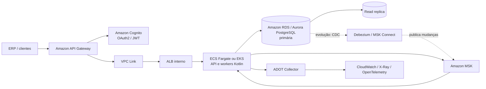

# Arquitetura de referência na AWS

Este diagrama representa um desenho de implantação para uma evolução em nuvem. Os
componentes AWS são uma proposta; a implementação local atual usa Docker Compose,
PostgreSQL e Kafka.

## Limites e responsabilidades

- API Gateway valida e aplica limites de borda. Cognito fornece tokens OAuth2/JWT;
  `X-Client-Id` é derivado da identidade autorizada, não aceito como identidade
  confiável diretamente do consumidor.
- VPC Link conecta o gateway ao balanceador interno. ALB distribui tráfego HTTP entre
  tasks ECS Fargate ou pods no EKS. A escolha entre ECS e EKS depende do padrão
  operacional da organização; não executar os dois por padrão.
- A API grava comandos, solicitações e outbox no RDS/Aurora PostgreSQL. Leituras
  consistentes ou recentes podem ir à primária; as demais podem usar réplica com a
  política de fallback filtrado da aplicação.
- O publicador do outbox e os consumidores usam MSK. Cada grupo possui progresso e
  DLQ independentes.
- ADOT coleta traces e métricas e encaminha para os backends corporativos. Segredos e
  certificados devem vir de Secrets Manager/Parameter Store e IAM, não de imagens.

## Evolução CDC

O desenho mantém polling do outbox como mecanismo inicial. Se a latência ou custo de
polling justificar, CDC com Debezium/MSK Connect pode publicar alterações do outbox
no MSK. Essa evolução requer retenção, compatibilidade de schema, operação de
connectors e deduplicação de eventos; não é requisito da configuração local.
